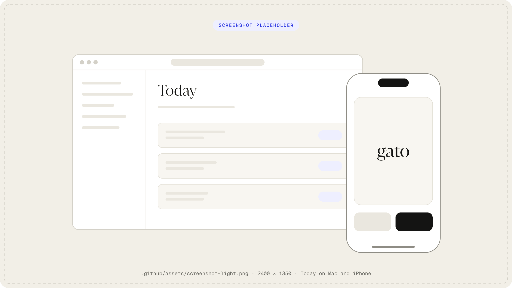

<p align="center">
  <picture>
    <source media="(prefers-color-scheme: dark)" srcset=".github/assets/hero-dark.svg">
    
  </picture>
</p>

<p align="center">
  <b>Open-source flashcards with a modern memory model.</b><br>
  FSRS, native apps everywhere, offline-first sync, and your Anki history.
</p>

<p align="center">
  <a href="https://rondo.matthewsource.com/app/"><b>Open the web app</b></a>
  &nbsp;·&nbsp;
  <a href="https://rondo.matthewsource.com/docs/">Docs</a>
  &nbsp;·&nbsp;
  <a href="https://discord.gg/GfftwYzbdV">Discord</a>
  &nbsp;·&nbsp;
  <a href="#features">Features</a>
  &nbsp;·&nbsp;
  <a href="#run-your-own">Run your own</a>
  &nbsp;·&nbsp;
  <a href="#how-it-works">How it works</a>
</p>

<p align="center">
  <a href="LICENSE"></a>
  <a href="https://github.com/sourcelocation/rondo/actions/workflows/ci.yml"></a>
  
  <a href="https://github.com/open-spaced-repetition/fsrs4anki/wiki/ABC-of-FSRS"></a>
</p>

> [!NOTE]
> Rondo is pre-release: web first, native apps next. Until hosting opens, [run it from source](#run-your-own).

<picture>
  <source media="(prefers-color-scheme: dark)" srcset=".github/assets/screenshot-dark.png">
  
</picture>

## Features

- FSRS-6 scheduling
- Personal FSRS weights
- Cloze deletions
- Image occlusion
- LaTeX & MathJax
- Furigana
- Pinyin
- Typed answers
- Text-to-speech
- Custom note types
- .apkg import
- .colpkg import
- Full review history
- Daily limits
- Suspend & bury
- Sub-decks & levels
- Shared decks
- Six native apps
- Works offline
- Background sync
- AI assistants (MCP)
- Free
- Open source
- Self-hostable

## How it works

```
 Web (React)    iPhone · iPad · Mac (SwiftUI)    Android (Compose)       AI assistants
      └────────────────┬──────────────────────────────┘                        │
       :client — SQLite, sync, sign-in, study, import, screens (Kotlin)       MCP
       :core   — the rules, models, markup, FSRS-6, levels (Kotlin)          │
                       │                                                       │
    rondo.matthewsource.com:  /  /docs  /app ──► static files                  │
    /api /media ──► Go server ──────────────┐        /sync /mcp ──► sync server (Kotlin, :core)
    /auth ──► Kratos ───────────────────────┤                                  │
    /oauth2 ──► Hydra ──────────────────────┴──────► one PostgreSQL ◄──────────┘
```

- **Local-first.** Apps use their own SQLite and never wait on the network; the newest row wins.
- **Progress is a log.** Reviews are never-overwritten events, so offline devices can't lose answers.
- **One set of rules.** `:core` checks every write, on devices and again on the sync server.
- **Spec-first for Go.** [`rondo.yaml`](server/api/rondo.yaml) generates the Go interfaces and API docs; Kotlin types are the sync contract.

[ARCHITECTURE.md](ARCHITECTURE.md) has the full map.

## Run your own

A Go server and a Kotlin sync server over PostgreSQL, with [Kratos](https://www.ory.sh/kratos/), [Hydra](https://www.ory.sh/hydra/) and any S3 store (or a folder).

[`server/compose.yaml`](server/compose.yaml) runs all of it from the released images; [the guide](https://rondo.matthewsource.com/docs/self-hosting) puts it on a server of your own. Below runs Rondo from source: Docker runs what Rondo depends on, and Rondo's own servers run on this machine (Go, JDK 25, Node 24 and pnpm), each reloading itself as you edit.

```bash
git clone https://github.com/sourcelocation/rondo.git
cd rondo/server && cp .env.example .env
# Postgres, Kratos, Hydra and Mailpit; they stay up, so this is only needed again after a reboot or a `down`
docker compose up -d --wait
```

```bash
cd app/platforms/web && pnpm install
# From the repository root: the Go server (:23901), the sync server (:23902) and the web app, http://localhost:23900/app/
overmind start
```

[`Procfile`](Procfile) lists the three, for [overmind](https://github.com/DarthSim/overmind) or any Procfile runner (`uvx honcho start` needs no install), or run each line in a terminal of its own. The Go server migrates and restarts on every save, the sync server rebuilds through Gradle, and the web app rebuilds the Kotlin client and proxies everything on one origin. Sign-in codes land in Mailpit at http://localhost:23908. Ports: 23900–23912 ([`server/compose.yaml`](server/compose.yaml)).

To run it as production does, from containers, stop the Procfile and add the `app` profile: `docker compose --profile app up --build` builds this checkout and serves the same address. `.env.example`'s secrets are public, for this machine only. Production runs four images on k3s.

## Repository

Four standalone projects, joined only by contract files.

| Project | Inside |
| --- | --- |
| [`server/`](server) | The Go server: accounts, sharing, billing, mail. Owns the API and schema. |
| [`app/`](app) | Kotlin core, client, MCP, sync server and [web app](app/platforms/web). |
| [`site/`](site) | The landing page (Astro) and the [docs](site/docs) (Fumadocs). |
| [`brand/`](brand) | Design tokens, fonts and artwork for every platform. |

<details>
<summary><b>Build and test</b></summary>

```bash
# Go server: lint, tests (with the compose Postgres)
cd server && golangci-lint run && go test ./...

# Kotlin: format, the rules on JVM and JS, the client, the sync server against Postgres and real clients
cd app && ./gradlew spotlessCheck :core:allTests :client:jvmTest :sync:test

# Web app
cd app/platforms/web && pnpm format:check && pnpm typecheck && pnpm build

# Sites: landing on :23911, docs on :23912
cd site && pnpm install && pnpm dev
cd site && pnpm dev:docs
```

</details>

## Contributing

Issues and PRs welcome; open an issue first for anything bigger than a fix. API changes start in the [spec](server/api/rondo.yaml).

Contributions fall under the [CLA](CONTRIBUTOR_LICENSE_AGREEMENT.md). Questions: support@matthewsource.com.

## License

[AGPL-3.0](LICENSE). The Rondo name and logo are trademarks; forks need their own ([`brand/artwork`](brand/artwork/README.md)).
